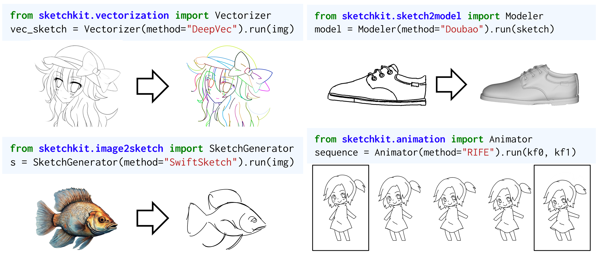

# SketchKit

SketchKit is a Python toolkit for loading, representing, processing, and rendering digital sketches. It is designed for researchers studying sketch data and developers building sketch-based applications, with unified APIs for datasets, vectorization, stroke ordering, image generation, colorization, animation, and 3D modeling.

[Documentation](https://cislab.hkust-gz.edu.cn/projects/sketchkit/docs/) · [Getting Started](docs/source/manual/0_get_started.md) · [API Reference](https://cislab.hkust-gz.edu.cn/projects/sketchkit/docs/api/sketchkit.html)



## Why SketchKit?

- **Unified sketch representation** — work with different datasets through the same `Sketch`, `Path`, `Curve`, and `Point` hierarchy.
- **14 built-in datasets** — load popular sketch datasets on demand and filter samples through pandas metadata.
- **Composable sketch workflows** — connect compatible datasets, processing methods, and renderers through a shared representation.
- **2D and 3D rendering** — rasterize vector strokes, render expressive brush strokes, or project 3D sketches from multiple camera views.
- **Research methods behind simple interfaces** — use task-level APIs such as `Vectorizer`, `Orderer`, `Colorizer`, and `Modeler`.

## Installation

SketchKit requires Python 3.12 or later and uses [uv](https://docs.astral.sh/uv/) for dependency and environment management.

Install `uv` on macOS or Linux:

```bash
curl -LsSf https://astral.sh/uv/install.sh | sh
```

On Windows PowerShell:

```powershell
powershell -ExecutionPolicy ByPass -c "irm https://astral.sh/uv/install.ps1 | iex"
```

Clone or download this repository, then install the project environment:

```bash
git clone https://github.com/CISLab-HKUST/SketchKit.git
cd SketchKit
uv sync
```

On macOS, the Cairo renderer also needs the system Cairo library. With Homebrew:

```bash
brew install cairo
export DYLD_FALLBACK_LIBRARY_PATH="$(brew --prefix)/lib${DYLD_FALLBACK_LIBRARY_PATH:+:$DYLD_FALLBACK_LIBRARY_PATH}"
```

For the RTSC contour renderer on macOS, install its native dependencies and
rebuild SketchKit:

```bash
brew install pkgconf glfw glew
uv sync --reinstall-package sketchkit
```

The build places the native executable in `sketchkit/renderer/_native/`.
RTSC uses a hidden OpenGL window and requires a working graphical session.
Its build is optional, so `uv sync` can succeed if RTSC fails to compile;
`NPRRenderer` reports missing binaries and native rendering errors when used.

Verify the installation:

```bash
uv run python -c "import sketchkit; print('SketchKit is ready')"
```

## Quick Start

Load a dataset, retrieve a vector sketch, and render it to a PNG:

```python
from sketchkit.datasets import OpenSketch
from sketchkit.renderer import CairoRenderer

dataset = OpenSketch()
sketch = dataset[0]

renderer = CairoRenderer()
image = renderer.render(sketch)
image.save("rendering.png")
```

Save the example as `quickstart.py`, then run:

```bash
uv run python quickstart.py
```

The script creates `rendering.png`. On first use, the OpenSketch adapter downloads its dataset automatically. Datasets are cached under `~/.sketchkit/datasets` by default; pass `root=...` to choose another location, or `cislab_source=True` to use the CIS LAB mirror where supported.

For complete pipelines covering vectorization, animation, NPR rendering, and stylization, see the [Getting Started guide](docs/source/manual/0_get_started.md).

## Unified Sketch Representation

Built-in dataset adapters convert sketches to the same vector structure:

```text
Sketch
└── Path
    └── Curve
        ├── Start Point
        ├── Control Point 1
        ├── Control Point 2
        └── End Point
```

A `Sketch` contains paths, each `Path` represents a continuous stroke, and each `Curve` is a cubic Bézier segment. Points store coordinates and can also carry pressure, thickness, color, opacity, and custom attributes.

Learn more in the [representation guide](docs/source/manual/1_representation.md).

## Supported Datasets

SketchKit currently includes 14 dataset adapters:

- LineDrawer
- QuickDraw
- ControlSketch
- TU-Berlin
- Tracing vs. Freehand
- OpenSketch
- SketchX-PRIS
- Sketchy
- PhotoSketching
- GMU Sketch Cleanup
- FS-COCO
- DifferSketching
- CreativeSketch
- SketchIME

Download behavior, source availability, metadata, and original representation vary by dataset. Check the [dataset guide](docs/source/manual/2_datasets.rst) and its dataset-specific pages before starting a large download.

All dataset classes expose `items_metadata`, a pandas `DataFrame` for filtering by fields such as category, split, and identifier:

```python
from sketchkit.datasets import ControlSketch

dataset = ControlSketch()
bears = dataset.items_metadata[
    (dataset.items_metadata["category"] == "bear")
    & (dataset.items_metadata["split"] == "validation")
]
sketches = [dataset[row.id] for _, row in bears.head(100).iterrows()]
```

See the [dataset guide](docs/source/manual/2_datasets.rst) for storage, lazy loading, metadata, and dataset-specific documentation.

## Methods

SketchKit organizes methods around sketches as the central representation. The table lists implementations documented in this repository; availability and setup requirements vary by implementation.

| Task | Documented implementations |
| --- | --- |
| Cleanup | MasterSketch |
| Vectorization | DeepVecSIG24, LineDrawer |
| Stroke ordering | Fu, LineDrawer |
| Animation | RIFE |
| Stylization | NeuralBrushstroke |
| Image to sketch | HED, PhotoSketch, SwiftSketch, AniLines |
| Sketch to image | ControlNet, Pix2Pix, T2I-Adapter, Nano Banana 2 |
| Colorization | ControlNet Lineart, ControlNet Scribble, MangaNinja |
| 3D modeling | Teddy, SENS, Seed3D |
| Non-photorealistic rendering | Suggestive Contours, Ridges and Valleys, Apparent Ridges |

Some methods require pretrained weights, a CUDA-capable GPU, external services or credentials, or additional assets. Check the corresponding page in the [methods guide](docs/source/manual/4_methods.rst) before use.

## Rendering

The rendering modules cover both 2D and 3D sketch visualization:

- **CairoRenderer** rasterizes vector sketches with configurable canvas and stroke options.
- **CialloRenderer** provides GPU-accelerated, brush-based vector stroke rendering.
- **DiffVGRenderer** projects `Sketch3D` Bézier curves into one or more camera views.

See the [2D renderer guide](docs/source/manual/renderers/renderer.md) and [3D renderer guide](docs/source/manual/renderers/3Drenderer.md) for examples and render options.

## Documentation

The complete documentation is available at:

<https://cislab.hkust-gz.edu.cn/projects/sketchkit/docs/>

Useful entry points:

- [Getting Started](docs/source/manual/0_get_started.md)
- [Sketch Representation](docs/source/manual/1_representation.md)
- [Supported Datasets](docs/source/manual/2_datasets.rst)
- [Methods](docs/source/manual/4_methods.rst)
- [Rendering](docs/source/manual/6_renderers.rst)
- [API Reference](https://cislab.hkust-gz.edu.cn/projects/sketchkit/docs/api/sketchkit.html)

## Contributing

Contributions for new datasets and processing methods are welcome. The manuals describe the expected unified interfaces, metadata conventions, module layout, tests, and GitHub workflow:

- [Dataset Contribution Guide](docs/source/manual/3_dataset_contribution.md)
- [Method Contribution Guide](docs/source/manual/5_method_contribution.md)
